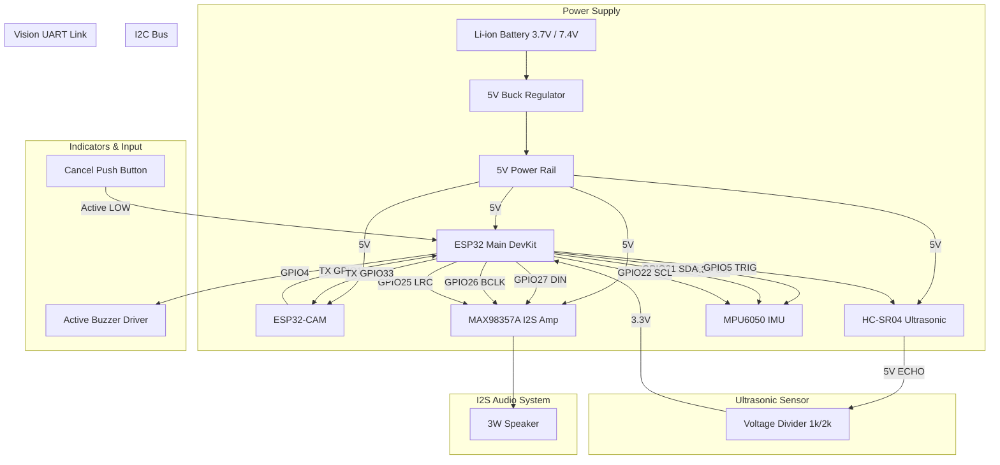

# Wiring & Hardware Interconnection Guide

This document specifies the exact physical wiring, power distribution, signal logic levels, and voltage divider requirements for the Assistive Device.

## 1. ESP32 Main Pinout Mapping

| Subsystem / Module | Module Pin | ESP32 Main Pin | Logic Level | Notes / Protection |
|---|---|---|---|---|
| **MPU-6050** | VCC | 3.3V | 3.3V Power | Direct 3.3V power |
| **MPU-6050** | GND | GND | Ground | Common Ground |
| **MPU-6050** | SDA | GPIO 21 | 3.3V I2C Data | Internal / External 4.7kΩ pull-up |
| **MPU-6050** | SCL | GPIO 22 | 3.3V I2C Clock | Internal / External 4.7kΩ pull-up |
| **HC-SR04** | VCC | 5V | 5V Power | High current 5V line |
| **HC-SR04** | GND | GND | Ground | Common Ground |
| **HC-SR04** | TRIG | GPIO 5 | 3.3V Output | Direct connection |
| **HC-SR04** | ECHO | GPIO 18 | **5V -> 3.3V Input** | **Must use Voltage Divider (1kΩ / 2kΩ)** |
| **MAX98357A I2S** | VIN / GND | 5V / GND | Power Rail | 5V power for maximum speaker volume |
| **MAX98357A I2S** | DIN | GPIO 27 | 3.3V I2S Data | I2S Data In |
| **MAX98357A I2S** | BCLK | GPIO 26 | 3.3V I2S Clock | I2S Bit Clock |
| **MAX98357A I2S** | LRC / WS | GPIO 25 | 3.3V I2S Clock | I2S Left-Right Word Select Clock |
| **Speaker** | +/- | Speaker Out | Analog Audio | Connect to 3W / 4Ω or 8Ω speaker |
| **ESP32-CAM** | TX (GPIO 1) | GPIO 32 (RX1) | 3.3V Input | Cross TX to RX |
| **ESP32-CAM** | RX (GPIO 3) | GPIO 33 (TX1) | 3.3V Output | Cross RX to TX |
| **Active Buzzer** | VCC (+) | GPIO 4 | 3.3V Output | NPN Transistor (2N2222) driver or direct GPIO |
| **Active Buzzer** | GND (-) | GND | Ground | Common Ground |
| **Cancel Button** | Pin 1 | GPIO 19 | 3.3V Input | Internal Pull-Up enabled |
| **Cancel Button** | Pin 2 | GND | Ground | Active LOW when pressed |

---

## 2. Voltage Level Shifting & Safety

### HC-SR04 Echo Voltage Divider
The HC-SR04 Echo pin outputs a 5V logic signal. Connecting 5V directly to ESP32 GPIO pins will damage the microcontroller. Use a simple two-resistor voltage divider:

```
  HC-SR04 ECHO (5V) ────[ 1kΩ Resistor ]────┬────> ESP32 GPIO 18 (3.3V max)
                                            │
                                     [ 2kΩ Resistor ]
                                            │
                                           GND
```
$$V_{out} = 5V \times \frac{2k\Omega}{1k\Omega + 2k\Omega} = 3.33V$$

---

## 3. Comprehensive Wiring Diagram (Mermaid)



---

## 4. Power & Common Ground Notes
1. **Common Ground:** All modules (ESP32 Main, ESP32-CAM, MPU6050, MAX98357A, HC-SR04, Buzzer) **MUST share a common ground (GND)** connection.
2. **Current Spikes:** ESP32-CAM Wi-Fi transmit pulses cause high peak current draws (>500mA). Add a 1000µF 10V electrolytic capacitor across the 5V and GND power rails near the ESP32-CAM to smooth voltage dips.
