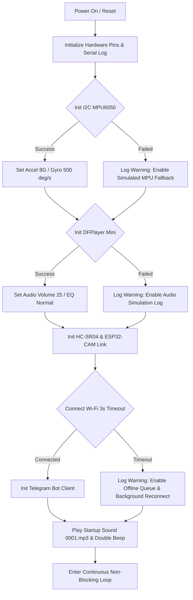
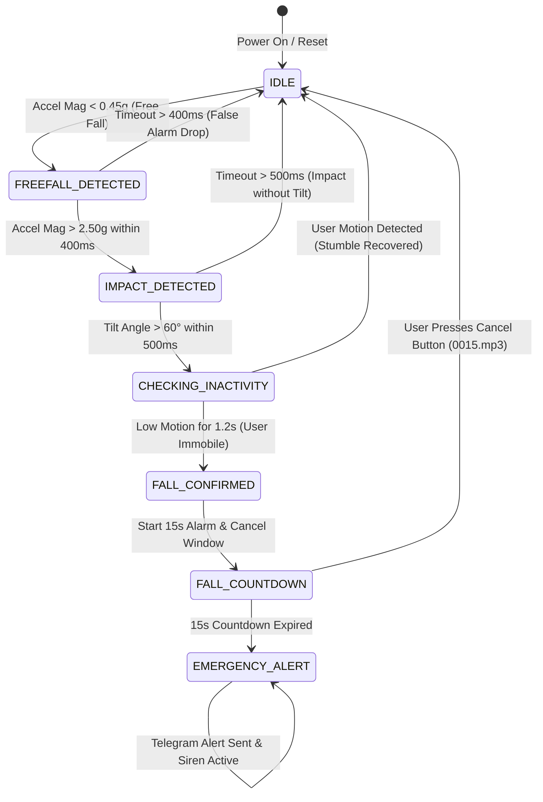
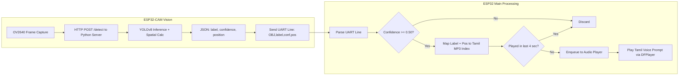
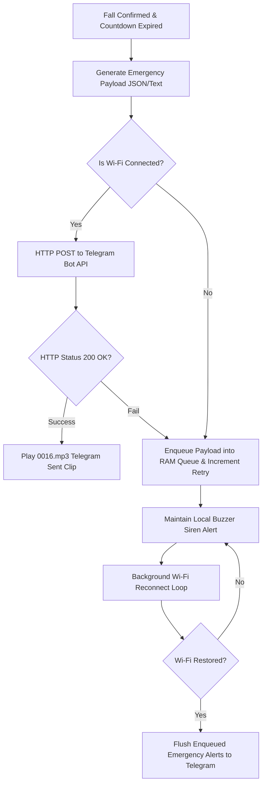

# System Workflow & Architectural Flowcharts

This document provides system flowcharts written in Mermaid diagram format for project reports, documentation, and technical presentations.

---

## 1. System Bootup & Degraded Feature Initialization Flowchart

---

## 2. Multi-Stage Fall Detection State Machine

---

## 3. Object Detection & Obstacle Navigation Pipeline

---

## 4. Telegram Alert & Offline Resiliency Pipeline

