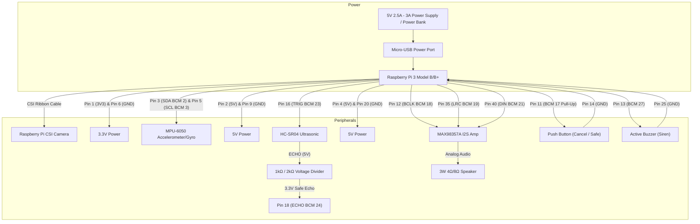

# Raspberry Pi 3 Hardware Wiring & Pinout Guide
### Smart Assistive System for Visually Impaired People

This guide provides the complete physical wiring mapping, voltage specifications, safety requirements, and schematic diagrams for connecting all sensors and peripherals directly to a **Raspberry Pi 3 Model B / B+**.

---

## ⚡ Master 40-Pin Header Wiring Table

| Peripheral / Module | Module Pin | Raspberry Pi Function | BCM GPIO | Physical Pin Number | Voltage Level | Electrical / Safety Notes |
| :--- | :--- | :--- | :---: | :---: | :---: | :--- |
| **MPU-6050** (Fall Sensor) | **VCC** | 3.3V Power | — | **Pin 1** | 3.3V | ⚠️ Never connect to 5V! |
| | **GND** | Ground | — | **Pin 6** | 0V | Common Ground reference |
| | **SDA** | I2C1 Data | **BCM 2** | **Pin 3** | 3.3V | Onboard 1.8kΩ pull-up on Pi |
| | **SCL** | I2C1 Clock | **BCM 3** | **Pin 5** | 3.3V | Onboard 1.8kΩ pull-up on Pi |
| **HC-SR04** (Ultrasonic) | **VCC** | 5V Power | — | **Pin 2** | 5V | Powers the ultrasonic transducers |
| | **GND** | Ground | — | **Pin 9** | 0V | Common Ground reference |
| | **TRIG** | Trigger Pulse | **BCM 23** | **Pin 16** | 3.3V Out | 10 µs pulse generated by Pi |
| | **ECHO** | Echo Signal | **BCM 24** | **Pin 18** | **3.3V In (via divider)** | ⚠️ **MUST USE 1kΩ / 2kΩ DIVIDER!** (See below) |
| **MAX98357A** (I2S Amp) | **VIN** | 5V Power | — | **Pin 4** | 5V | Powers 3W amplifier rail |
| | **GND** | Ground | — | **Pin 20** | 0V | Common Ground reference |
| | **BCLK** | Bit Clock | **BCM 18** | **Pin 12** | 3.3V Out | Continuous I2S bit clock |
| | **LRC / WS** | Word Select | **BCM 19** | **Pin 35** | 3.3V Out | Left/Right word select clock |
| | **DIN** | Serial Data | **BCM 21** | **Pin 40** | 3.3V Out | I2S digital audio stream |
| **Speaker** (3W / 4Ω or 8Ω)| **(+) / (-)** | Speaker Output | — | **Amp Terminals** | Audio | ⚠️ Connect ONLY to MAX98357A terminals! |
| **Cancel Button** | **Pin 1** | Input | **BCM 17** | **Pin 11** | 3.3V In | Internal pull-up enabled |
| | **Pin 2** | Ground | — | **Pin 14** | 0V | Connects pin to GND when pressed |
| **Emergency Buzzer** | **(+) Signal**| Alarm Out | **BCM 27** | **Pin 13** | 3.3V Out | Active HIGH emergency siren |
| | **(-) Ground**| Ground | — | **Pin 25** | 0V | Common Ground reference |
| **CSI Camera** | **15-pin Ribbon**| CSI Interface | — | **CSI Port** | Dedicated | Dedicated connector between HDMI & Audio |

---

## 🛡️ Critical Safety Requirements & Circuits

### 1. HC-SR04 Echo 5V $\rightarrow$ 3.3V Voltage Divider
The HC-SR04 operates at 5V, so its **ECHO** pin outputs a 5V logic signal when sound waves return. Connecting 5V directly to Raspberry Pi GPIO pins will permanently burn the GPIO pad or the entire SoC!

You **must** wire this exact 2-resistor voltage divider:

```
  HC-SR04 ECHO (5V) ────[ 1 kΩ Resistor ]────┬────> Raspberry Pi Physical Pin 18 (BCM GPIO 24)
                                             │
                                      [ 2 kΩ Resistor ]
                                             │
                                            GND (Physical Pin 9 or 14)
```

$$\text{Voltage at GPIO} = 5\text{V} \times \frac{2\text{ k}\Omega}{1\text{ k}\Omega + 2\text{ k}\Omega} = 3.33\text{ V (Safe for Pi)}$$

---

### 2. Raspberry Pi CSI Ribbon Camera Connection

1. **Power off the Raspberry Pi 3** before connecting or disconnecting the ribbon cable.
2. Locate the **CSI Camera port** (the connector labelled `CAMERA` between the HDMI port and the 3.5mm audio jack).
3. Gently pull the connector latch collar **upwards** with two fingers until it pops up slightly (do not force it).
4. Insert the 15-pin ribbon cable:
   - **Silver contacts** must face **towards the HDMI port**.
   - **Blue reinforcing plastic tape** must face **towards the 3.5mm audio jack and USB ports**.
5. Push the ribbon cable firmly and evenly into the slot.
6. Push the plastic collar down to lock the cable firmly in place.

---

### 3. Emergency Buzzer Driver Circuit
Standard 5V active buzzers consume 25–35 mA at 5V. Because individual Raspberry Pi GPIO pins can safely supply a maximum of 16 mA:
- If using a **3.3V low-current piezo buzzer**, connect (+) directly to **BCM 27 (Pin 13)** and (-) to **GND (Pin 25)**.
- If using a **5V high-volume active buzzer**, use a standard NPN transistor (2N2222 or BC547) as shown below:

```
                  +5V (Physical Pin 2)
                   │
                [ Buzzer (+) ]
                [ Buzzer (-) ]
                   │
               Collector
  BCM 27 ──[ 1 kΩ ]─── Base (2N2222 NPN)
               Emitter
                   │
                  GND (Physical Pin 14)
```

---

### 4. Power Supply Rules (DO NOT USE A 9V BATTERY)

> [!CAUTION]
> **NEVER use a rectangular 9V (PP3) battery.**
> 1. A 9V battery will immediately destroy the Raspberry Pi if connected to the 5V or 3.3V pins.
> 2. Standard 9V batteries can only supply 50–100 mA before their voltage collapses. A Raspberry Pi 3 with camera, I2S amplifier, and sensors requires **1.5A to 2.5A at 5.0V**.

#### Recommended Power Source:
- **Bench / Wall Power:** Official 5V 2.5A or 5V 3.0A Micro-USB power adapter.
- **Portable / Battery Power:** A standard USB Power Bank (5V with a 2.4A or 3A output rating) connected via a thick, short Micro-USB cable.
- **Common Ground:** All sensor grounds (MPU6050, HC-SR04, MAX98357A, Buzzer, Button) must connect to the Raspberry Pi GND rail.

---

## 🗺️ Mermaid Hardware Connection Diagram


